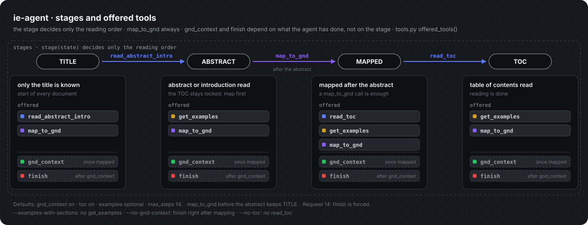

# KI-FSPrompt and the ie-agent: from knowledge-injected prompting to agentic subject indexing

This repository holds two systems for automated GND subject indexing at the Deutsche Nationalbibliothek (DNB):

1. **KI-FSPrompt** (Kähler, Konermann, Kluge 2025): a pipeline with retrieved few-shot examples, mapping onto the
   GND by embedding similarity, and an LLM ranking stage. See [KI-FSPrompt](#ki-fsprompt-knowledge-injected-few-shot-prompting) below.
2. **ie-agent** (this branch, master's thesis by Cezar Harb): an agent built on KI-FSPrompt. It reads a document in
   the order human subject indexers do, maps its candidates with the KI-FSPrompt mapping step, and checks them
   against the GND knowledge graph before assigning them. See [`ie_agnet/`](ie_agnet/README.md).

The agent does not replace the pipeline. It reuses the pipeline's data, few-shot retrieval, vocabulary, mapping and
evaluation, and changes **how the model reaches its decision**.

| Qwen3.8-27B, validation split, 827 documents | F1 | Precision | Recall |
|---|---|---|---|
| KI-FSPrompt, title | 0.379 | 0.393 | 0.397 |
| KI-FSPrompt, best fixed input (title + abstract/introduction) | 0.383 | 0.379 | 0.428 |
| **ie-agent, base condition** (mean of 3 identical runs) | **0.491** | **0.503** | **0.525** |
| Oracle: best fixed input chosen per document using the gold standard | 0.520 | | |

All values are casimir document averages at 100 on the validation split. The test split has not been used yet (see
[Limitations](#limitations-of-the-extension)).

## Starting point: limitations of KI-FSPrompt

The KI-FSPrompt paper and its code leave four points open. Each one motivates a part of the agent.

| | Limitation | Where it shows | What the ie-agent does |
|---|---|---|---|
| **L1** | **One fixed input text for all documents.** The pipeline always sees the same part of a document (in this repository: the title). | Indexers read the title, then the abstract or introduction, then the table of contents only if needed. In our runs, the best fixed input reaches F1 0.383, the oracle 0.520: the right text depends on the document, and no feature known before generation predicts it. | The agent starts with the title and requests further sections itself. The reading order of the indexers is enforced in code (stages). |
| **L2** | **Mapping by string similarity only.** Each keyword gets its single nearest GND heading above a cosine threshold of 0.7 ([`src/mapping.py`](src/mapping.py)). Definition, using instructions and position in the hierarchy are not used. | Example from our logs: *Sport und Politik* → *Politik* (0.714). The paper names this as future work: *"keywords are organized in a knowledge graph-like structure. Future research could explore how to leverage the relationships between keywords"* (§6). | Tool `gnd_context`: after mapping, the agent looks up each candidate's GND record (definition, using instructions, subject category, broader/narrower/related terms with relation kind, frequency in training) and its relations to the other candidates. Only then may it finish. |
| **L3** | **The number of headings is not controlled.** The paper reports recall@5 well above precision@5 (§5.1) and attributes the number of predicted terms to the retrieved examples (A.4). | Earlier agent versions assigned 6–8 headings per document, the gold standard has 4.9. Model suggestions contain a broader and a narrower term together in 62 % of documents, the gold standard in 7 % (RSWK specificity rule). | Prompt rules derived from error analysis: usually 3–6 headings, rarely assigned headings need clear evidence in the text, prefer the most specific heading. Result: 4.7 headings per document. |
| **L4** | **Precision is the weak point.** The mapping step decides by similarity, the ranking stage rates heading against text, neither checks the heading's meaning. | — | Every component that helps the agent *select* (GND graph, reasoning, RSWK rules) raises precision. Components that only give it *more text* do not raise F1 (see results). |

Two further points from the paper are **not** addressed by the agent: the dependence on similar training documents
(distribution shift between dev and test, §5.3), and the low cost that motivated KI-FSPrompt (two LLM calls per
document). The agent is considerably more expensive, see [Cost](#cost).

## How the extension came about

The thesis started with a different question: **does the choice of input text improve few-shot prompting?** The
path to the agent, in short:

| Step | Question | Finding |
|---|---|---|
| 1. Selections | Do abstract, introduction or table of contents, extracted with Docling, beat the title? ([`README_Selektion.md`](README_Selektion.md)) | No fixed selection clearly beats the title. Longer input brings more headings and lower precision. |
| 2. Complementarity | Do the inputs find *different* headings? | Yes. Together they cover 53 % of the gold headings instead of 32 %. Simply merging them hurts (precision drops). |
| 3. Oracle | How good would choosing the best input per document be? | +14 F1 points over the best fixed input. No feature known before generation predicts the winner. |
| 4. Fusion and router | Can the inputs be combined after generation? | Agreement between runs is a strong signal: fusion 0.411, keyword router with GND graph features 0.436. Needs five runs per document. |
| 5. Agent | Can one model decide what to read, like an indexer? | Agent without GND tool 0.436, with one model run instead of five. High recall, low precision. |
| 6. Knowledge graph | Can the GND help the agent check its candidates? | `gnd_context` adds +2 to +3 F1 points, almost entirely through precision. It works as a filter. |
| 7. Indexer order in code | Does the agent follow the reading order of the indexers? | Only when the code enforces it. Left alone, the agent is greedy with tokens and reads almost everything. With the order enforced, it reads the table of contents in 56 % instead of 94 % of documents, at the same quality. |
| 8. Ablation | Which component actually helps? | 16 conditions (reasoning × graph × table of contents × examples), see below. |

## The ie-agent



In every step the model only sees the tools allowed at its stage:

| Tool | Purpose | From KI-FSPrompt |
|---|---|---|
| `read_abstract_intro`, `read_toc` | read the next section (Docling extraction) | same sections as the selection conditions |
| `get_examples` | few-shot examples for a section | retrieved examples of the pipeline (`retrieved_examples.csv`) |
| `map_to_gnd` | map free keywords onto GND headings | the mapping step: Weaviate hybrid search, BGE-M3, threshold 0.7 |
| `gnd_context` | look up candidates in the GND graph | new: [`ie_agnet/src/ie_agent/gnd/`](ie_agnet/src/ie_agent/gnd/), built from the pipeline vocabulary and DNB open data (CC0) |
| `finish` | assign the final headings | only IDs seen through a tool are accepted; output in the format of `mapped_predictions.csv` |

Every run writes `mapped_predictions.csv` and is scored with the same casimir setup as `src/compute_metrics.R`, so
agent and pipeline results are directly comparable. Installation, commands and the full description are in
[`ie_agnet/README.md`](ie_agnet/README.md).

## Results

Ablation over 16 conditions, each on the same 827 validation documents. "F1 without / with" is the mean over the 8
pairs of runs that differ only in this component. Details:
[`ablation_analysis.md`](ie_agnet/results/Qwen3.8-27B-FP8/ablation_analysis.md),
[`gnd_context_analysis.md`](ie_agnet/results/Qwen3.8-27B-FP8/Wissensgraph_analysis/gnd_context_analysis.md).

| Component | F1 without | F1 with | Precision | Recall | Verdict |
|---|---|---|---|---|---|
| **GND knowledge graph** (`gnd_context`) | 0.458 | **0.489** | 0.439 → 0.492 | 0.527 → 0.533 | **helps, significant in all 8 pairs** |
| **Reasoning** | 0.468 | **0.479** | 0.457 → 0.474 | 0.530 → 0.530 | **helps, significant** (about +1 min per document) |
| RSWK rules in the prompt | 0.484 | 0.497 | 0.482 → 0.514 | 0.531 → 0.529 | helps in a single comparison, repetition needed |
| Full text (PDFBox, 30k characters) instead of Docling section | 0.491 | 0.496 | 0.503 → 0.494 | 0.525 → 0.545 | no significant difference, twice the tokens |
| Table of contents available | 0.475 | 0.473 | 0.471 → 0.460 | 0.527 → 0.534 | does not help |
| Examples forced with every section | 0.473 | 0.474 | 0.468 → 0.463 | 0.526 → 0.535 | does not help |

**The pattern:** components that help the agent **select** raise precision and with it F1. Components that give it
**more text** find slightly more correct headings but bring as many wrong ones, so F1 stays the same.

Within the knowledge graph, the relation kinds (*kind of*, *part of*, *instance of*, from ISO 25964 and the GND
ontology) contribute significantly (F1 −0.011 without them). Choosing narrower terms by similarity instead of
frequency makes no detectable difference.

For Docling the full-text comparison means: the Docling section reaches the same quality as 30,000 characters of
full text with less than half the tokens. Docling pays off here as an efficiency gain, not as a quality gain.

### Cost

| Base condition, per document | KI-FSPrompt (title + abstract/introduction) | ie-agent |
|---|---|---|
| Input tokens | about 9,900 | about 31,500 |
| Model calls | 1 generation (+ ranking) | about 6 steps |
| Time | — | about 90 s (with reasoning about 180 s) |

The agent is about three times as expensive in tokens. `resource_stats.json` in every run folder records time,
tokens and GPU energy.

## Limitations of the extension

- **Validation split only.** All components and prompt rules were developed on the same 827 documents. The numbers
  are optimistic until the frozen final version has run once on the test split.
- **Non-determinism.** Three identical runs of the base condition range from F1 0.487 to 0.495 despite
  `temperature=0`. Differences below about 0.008 between two single runs can be chance. Components were therefore
  compared over 8 pairs each, with a per-document sign-flip permutation test.
- **One model.** All agent results use Qwen3.8-27B-FP8.
- **The graph filters, it does not find.** Of 35,644 terms shown by `gnd_context`, the agent adopted 38. About 30 %
  of the gold headings are never seen by the agent. Recall needs further candidate sources.
- **AUCpr says little.** Almost all agent outputs have the score 1.0 (they come from the mapping step), so AUCpr is
  close to precision × recall. Ranked output would be needed for AUCpr as the main metric.
- **Gold standard is incomplete.** Some "wrong" headings may be appropriate. The best runs therefore also go to a
  graded-relevance assessment by subject indexers.

## Repository layout

| Path | Content | Part of |
|---|---|---|
| `src/`, `pipelines/`, `instructions/`, `vocab/` | KI-FSPrompt pipeline | original |
| `src/preprocess_selektion.py`, `src/data_adapters/`, `src/combine_selections.py` | Docling selections and combined conditions | this branch, [`README_Selektion.md`](README_Selektion.md) |
| `ie_agnet/` | the ie-agent: code, prompts, GND graph builder, tests, walkthrough notebooks | this branch, [`ie_agnet/README.md`](ie_agnet/README.md) |
| `ie_agnet/results/<model>/` | one folder per run, named after its conditions | this branch |
| `docs/img/` | figures | this branch |

---

# KI-FSPrompt: Knowledge Injected Few-Shot Prompting

This repository contains a research prototype for the task of automated subject
indexing, featuring a system developed for the shared task [LLMs4Subjects](https://sites.google.com/view/llms4subjects-germeval).

KI-FSPrompt core idea is a simple few-shot
prompting approach, where a generative LLM is presented
with a limited number of examples
of texts annotated with subject terms, and
prompted to identify the most relevant subject
terms for a new input text. To ensure alignment
with the library’s normed subject terms, we employ
a mapping approach based on embedding
similarity. We extend our [previous work](https://github.com/deutsche-nationalbibliothek/semeval25_llmensemble) by
incorporating a retrieval stage, which selects
relevant few-shot examples from the training
set to create knowledge-injected prompts, enabling
the LLM to provide more specific and
accurate keyword suggestions.

## Installation

### Step 1: Create virtual environment for ki-fsprompt

```bash
uv sync
```

Activate environment

```bash
source .venv/bin/activate
```

### Step 2: Start Docker services

The file `docker-compose.yaml` configures two services. Weaviate as a vector
storage and Hugging Face TEI as a service for embedding generation. 

```bash
docker compose --file docker-compose.yaml up
```

### Step 3: Create virtual R-environment for eval-stage

If you have a working R installation on your system, we recommend the following
packages:

```R
# fetch dependencies (all from CRAN)
install.packages("casimir", "optparse", "svglite", "rjson", "yaml")
# fetch polars (not from CRAN)
Sys.setenv(NOT_CRAN = "true") 
install.packages("polars", repos = "https://community.r-multiverse.org")
```

If you have no R installation, you may use conda to create a virtual environment
for your R dependencies. 

```bash
conda create --file r-environment.yml
conda activate r-eval
# install polars bindings for R
Rscript -e 'Sys.setenv(NOT_CRAN = "true"); install.packages("polars", repos = "https://community.r-multiverse.org")'
```

### Step 4 (optional): ie-agent

The agent has its own environment and command. It needs Steps 1–3 and the outputs of the pipeline. See
[`ie_agnet/README.md`](ie_agnet/README.md#quick-start).

## Running the program

This repository relies on [Data Version Control](dvc.org) (DVC) to orchestrate
the dependencies of all steps necessary to run the complete program. 
 
In particular, there are three separate DVC-pipeline, executing the various
stages of the KI-FSPrompt System.

* `pipeline/preprocess/dvc.yaml`: Takes the corpora from raw input format to the required output format.
* `pipeline/train/dvc.yaml`: Creates the document collection for retrieving
  documents, indexes a small dev-set and trains the post-processing ranker on the
  dev-set.
* `pipeline/predict/dvc.yaml`: Indexing of a test set and evaluation

Each pipeline can be run with `dvc repro dvc.yaml` and has its own parameters
`params.yaml` as well as shared parameters in `pipelines/shared_params.yaml`
to configure the pipeline.

Run a single stage and its dependencies:

```bash
dvc repro pipelines/train/dvc.yaml:compute_metrics_modelwise@mistral-7B-0p3
```

For interactive use, start and stop the vLLM service with

```bash
docker compose up vllm
docker compose down vllm
```

## Data input

This project is run with a dataset of German open access dissertations. The
data is currently not at public disclosure. 

## Citation

You can cite this work as:

```bibtex
@inproceedings{kahler-etal-2025-dnb,
    title = "{DNB}-{AI}-Project at the {G}erm{E}val-2025 {LLM}s4{S}ubjects Task: {KIFSP}rompt - Knowledge-Injected Few-Shot Prompting",
    author = {K{\"a}hler, Maximilian  and
      Kluge, Lisa  and
      Konermann, Katja},
    editor = "Wartena, Christian  and
      Heid, Ulrich",
    booktitle = "Proceedings of the 21st Conference on Natural Language Processing (KONVENS 2025): Workshops",
    month = sep,
    year = "2025",
    address = "Hannover, Germany",
    publisher = "HsH Applied Academics",
    url = "https://aclanthology.org/2025.konvens-2.42/",
    pages = "455--464"
}
```
