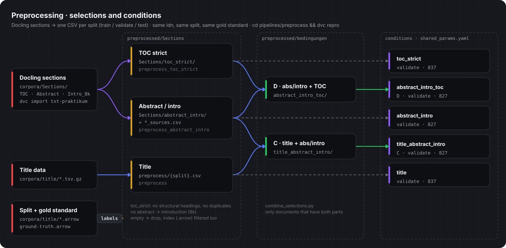
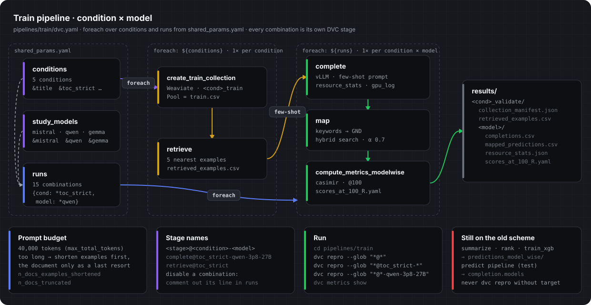

# Selection-based Preprocessing

Working branch `Preprocessing_selections` · Cezar Harb · Master's thesis at the DNB

This thesis investigates **how the choice of input text affects the quality of automated
GND subject indexing**. The idea comes from intellectual subject indexing practice: people
do not read the whole book, they look specifically at the table of contents, the abstract
and the introduction. Exactly these parts are extracted automatically here (Docling) and
compared as input for few-shot prompting.

## What changes compared to the original setup

The original KI-FSPrompt (project by Maximilian Kähler) was designed to **switch between
models**: one fixed dataset (titles), with `complete`, `map` and
`compute_metrics_modelwise` running via `foreach` over `completion.models`.

This thesis additionally needs to **switch between datasets**, i.e. between individual
sections (title, abstract/introduction, table of contents) and combinations of them.
Instead of rewriting the parameter files before every run, all conditions are therefore
part of the DVC graph at the same time:

| | Original | This branch |
|---|---|---|
| Axis | model only | condition × model |
| Controlled by | `completion.models` | `conditions`, `study_models`, `runs` in `shared_params.yaml` |
| Stage name | `complete@mistral-7B-0p3` | `complete@toc_strict-mistral-7B-0p3` |
| Results | `predictions_model_wise/<model>/` (overwritten) | `results/<condition>_validate/<model>/` (kept) |
| Switching condition | edit parameters, rerun | call a different stage name |

DVC only recomputes what has changed. Switching between conditions therefore costs
nothing as long as their results are up to date.

## The conditions



| Condition | Content | Data under `pipelines/preprocess/preprocessed/` |
|---|---|---|
| `title` | title data (baseline) | – (`pipelines/preprocess/{split}.csv`) |
| `abstract_intro` | abstract, otherwise introduction (first 8,000 characters) | `Sections/abstract_intro/` |
| `toc_strict` | table of contents without structural headings and duplicates | `Sections/toc_strict/` |
| `title_abstract_intro` (C) | title + abstract/introduction | `bedingungen/title_abstract_intro/` |
| `abstract_intro_toc` (D) | abstract/introduction + TOC strict | `bedingungen/abstract_intro_toc/` |

Every condition runs with three models: `mistral-7B-0p3`, `qwen-3p8-27B`, `gemma-4-31B-fp8`.

The preprocessing additionally contains `toc` (TOC with light cleaning) as a comparison
variant for `toc_strict`. It is not a condition in `runs`.

## How the control works



```
pipelines/shared_params.yaml
  conditions:    per condition: train/validate/index, collection, instruction
  study_models:  the three models of the comparison
  runs:          which combinations run (references both via YAML anchors)

pipelines/train/dvc.yaml
  create_train_collection, retrieve    foreach: ${conditions}   (depend on the text only)
  complete, map, compute_metrics_...   foreach: ${runs}         (text and model)
```

- **Disable a combination:** comment out its line in `runs`.
- **Sampling parameters** (`completion.vllm.samplingparams`, `vllm.*`) are the same for
  all runs and stay fixed across conditions, otherwise the results are not comparable.
- `completion.models` and `completion.custom_instruction` are no longer read by the train
  pipeline. The predict pipeline still uses them (see [Open issues](#open-issues)).
- If `dvc exp run -S` rewrites the file, the YAML anchors (`&` / `*`) can get lost.
  Change parameters directly in the file instead.

### Why `runs` with YAML anchors

The obvious choice would have been DVC's `matrix`, which combines every condition with
every model by itself. For a dict, however, `matrix` only provides the **key** (e.g.
`toc_strict`), not the fields below it. `${item.cond.train}` or `${item.cond.instruction}`
do not work there, and those are exactly the fields every stage needs.

That is why there is `runs`: a dict in which every entry contains both blocks in full,
together with `foreach: ${runs}` in `dvc.yaml`. To avoid writing out every condition 3×
and every model 5×, YAML anchors are used:

```yaml
conditions:
  toc_strict: &toc_strict          # &name gives the block a name
    name: toc_strict
    train: ...
study_models:
  qwen-3p8-27B: &qwen
    hf_model_name: Qwen/Qwen3.8-27B-FP8
    ...
runs:
  toc_strict-qwen-3p8-27B: {cond: *toc_strict, model: *qwen}   # *name inserts a copy
```

This way every condition and every model appears only once in the file. A change, e.g.
to a path or to the instruction, applies automatically to all combinations. The key in
`runs` becomes the part after the `@` in the stage name.

`create_train_collection` and `retrieve`, on the other hand, iterate over `conditions`
rather than `runs`. The collection and the few-shot retrieval depend only on the text, so
they are built once per condition instead of three times (once per model).

## Usage

All commands are run from the respective pipeline folder. Without a path, DVC uses the
`dvc.yaml` in the current folder.

### 0. Setup and prerequisites

Installation (Python environment, R packages for casimir) is described in
[README.md](README.md#installation). Short version:

```bash
uv sync
source .venv/bin/activate
```

**Docker services.** Weaviate (port 8087) and TEI for the embeddings (port 8090) must be
running for collection, retrieval and mapping:

```bash
docker compose --file docker-compose.yaml up weaviate text_embeddings_inference
```

The `vllm` service (port 9513) is only for interactive use, e.g. in the notebook. The
pipeline starts vLLM itself. Stop the container before GPU runs so it does not occupy
GPU memory:

```bash
docker compose up vllm      # start
docker compose down vllm    # stop
```

**Weaviate collections.** `map` needs the vocabulary collection (GND), `retrieve` needs
one train collection per condition. Normally DVC creates both automatically. If they are
missing, e.g. after restarting Weaviate without a volume, rebuild them like this:

```bash
cd pipelines/train
dvc repro -s -f create_vocab_collection                 # GND vocabulary, once for all
dvc repro -s -f --glob "create_train_collection@*"      # retrieval pool of all conditions
dvc repro -s -f create_train_collection@toc_strict      # or a single condition
```

`-f` forces the rebuild even if DVC considers the stage up to date. This is necessary
here because DVC only sees the manifest file and does not check whether the collection
actually exists in Weaviate. Embedding the vocabulary takes a long time, so only do this
when needed.

`complete` needs a free GPU.

### 1. Preprocessing

```bash
cd pipelines/preprocess

dvc repro                                              # everything
dvc repro --glob "preprocess_toc_strict@*"             # one selection, all three splits
dvc repro --glob "preprocess_abstract_intro@*"
dvc repro --glob "combine_title_abstract_intro@*"      # condition C
dvc repro --glob "combine_abstract_intro_toc@*"        # condition D
dvc repro preprocess_toc_strict@toc_strict_validate    # a single split
```

The combinations C and D depend on the individual selections. DVC recomputes those
automatically if they are outdated.

### 2. Full run: all conditions × models

```bash
cd pipelines/train
dvc repro --glob "*@*"
```

The pattern matches all stages containing `@`, i.e. all conditions and combinations.
`summarize`, `rank` and `train_xgb` have no `@` and are left out. Start long GPU runs in
`tmux` or `screen`. If a run is interrupted, DVC only recomputes what is missing on the
next call.

> **Warning:** Never call `dvc repro` without a stage name in `pipelines/train`. That
> would also run `summarize`, `rank` and `train_xgb`, which still point to the old
> `predictions_model_wise/` and fail.

### 3. Targeting individual conditions and models

Every combination produces three stages that share the part after the `@`:

```
complete@<condition>-<model>
map@<condition>-<model>
compute_metrics_modelwise@<condition>-<model>
```

`--glob "*@..."` addresses all three at once, without having to know the stage name
before the `@`:

```bash
cd pipelines/train

# exactly one combination
dvc repro --glob "*@abstract_intro_toc-gemma-4-31B-fp8"

# one condition, all models
dvc repro --glob "*@toc_strict-*"

# one model, all conditions
dvc repro --glob "*@*-qwen-3p8-27B"
```

The quotes are needed so the shell does not replace `*` with file names. `*` also
matches `_`: `"*@abstract_intro*"` therefore also matches `abstract_intro_toc`. The hyphen
makes the boundary unambiguous: `"*@abstract_intro-*"`.

Only a single step of a combination (the full stage name is needed here):

```bash
dvc repro complete@toc_strict-mistral-7B-0p3
dvc repro retrieve@title_abstract_intro      # collection/retrieval: condition name only
```

| Flag | Effect |
|---|---|
| `--dry` | only shows what would run |
| `-s` | only the given stage, without checking upstream stages |
| `-f` | forces a rerun |
| `--glob` | glob pattern for several stages |

Example: recompute only the mapping without touching the completion:

```bash
dvc repro -s -f map@toc_strict-qwen-3p8-27B
```

**From the repo root.** If you do not want to change into the pipeline folder, prefix
the path to `dvc.yaml`. This corresponds to the targeted execution in
[README.md](README.md). There it was `compute_metrics_modelwise@mistral-7B-0p3`, now the
condition is added:

```bash
dvc repro pipelines/train/dvc.yaml:compute_metrics_modelwise@title-mistral-7B-0p3
dvc repro --glob "pipelines/train/dvc.yaml:*@title-mistral-7B-0p3"
dvc repro pipelines/preprocess/dvc.yaml:preprocess_toc_strict@toc_strict_validate
```

DVC always runs outdated upstream stages as well (unless `-s` is given).

Overview: `dvc stage list` (all stage names), `dvc status` (what is outdated),
`dvc dag` (dependencies).

### 4. Results

```
pipelines/train/results/<condition>_validate/
  collection_manifest.json
  retrieved_examples.csv
  <model>/
    completions.csv, gpu_log.csv, resource_stats.json      (complete)
    mapped_predictions.csv, mapping_stats.json             (map)
    scores_at_100_R.yaml                                   (compute_metrics_modelwise)
```

```bash
dvc metrics show          # all metrics
dvc metrics diff main     # compare with main
```

`resource_stats.json` contains runtime, token counts and energy consumption of the
completion.

To compare two conditions at candidate level (how much of a difference is a real loss in
quality and how much is only due to the number of candidates):

```bash
python src/compare_conditions.py --k 5 \
  Title=pipelines/train/results/title_validate/mistral-7B-0p3/mapped_predictions.csv \
  TOC=pipelines/train/results/toc_strict_validate/mistral-7B-0p3/mapped_predictions.csv
```

### 5. Saving

After a run, commit `dvc.lock` and the metric files, and push the outputs to the remote
cache with `dvc push`.

## Adding a new condition

1. **Preprocessing:** in `pipelines/preprocess/params.yaml`, add a `<name>_datasets`
   block for train/validate/test, and a matching stage in `pipelines/preprocess/dvc.yaml`
   (`preprocess_selektion.py` for a section, `combine_selections.py` for a combination).
2. **Instruction:** write `instructions/instruction_<name>.txt`.
3. **Register the condition** in `shared_params.yaml` under `conditions`:
   ```yaml
   <name>: &<name>
     name: <name>
     train: ../preprocess/preprocessed/.../train.csv
     validate: ../preprocess/preprocessed/.../validate.csv
     validate_index: ../preprocess/preprocessed/.../validate.arrow
     collection: <name>_train          # own name per condition!
     instruction: instructions/instruction_<name>.txt
   ```
4. **Register the runs:** one line per model in `runs`:
   ```yaml
   <name>-mistral-7B-0p3:  {cond: *<name>, model: *mistral}
   ```
5. **Run:** `dvc repro --glob "*@<name>-*"`

No changes to the train pipeline's `dvc.yaml` are needed.

## Data principle

All conditions use **the same documents, the same IDs, the same split and the same gold
standard**. Only the `text` column changes. This is what makes the conditions comparable.

```
corpora/title/{split}.arrow       which idn belongs to which split
corpora/ground-truth.arrow        gold standard per idn (same source as casimir)
corpora/Sections/                 Docling extractions (TOC, abstract, introduction)
        |
        v   preprocess_selektion.py / combine_selections.py
pipelines/preprocess/preprocessed/.../{train,validate,test}.csv + .arrow
        |
        v   unchanged: retrieve -> complete -> map -> casimir
```

| Split | Role | Index |
|---|---|---|
| train | retrieval pool for the few-shot examples | `corpora/title/train.arrow` |
| validate | comparison of conditions | `corpora/title/validate.arrow` |
| test | evaluation | `corpora/title/test.arrow` |

The downstream stages only read the columns `text, doc_id, label_ids, label_texts` (see
`src/data_adapters/constants.py`). Any selection that writes this schema fits into the
pipeline without further changes.

The sections come via `dvc import` from `aen/txt-praktikum` (`datasets/Sections`), pinned
in `corpora/Sections.dvc` via `rev_lock`. The extraction is therefore a fixed constant.

## Decisions and rationale

**Labels directly from `ground-truth.arrow`.** The file contains GND URI and label text
and is the same source casimir uses for evaluation. This way the selection cannot run
against a different gold standard than the evaluation.

**`cleaning: toc` / `toc_strict`.** Bullet points, chapter numbers and page references
`(S. 5)` contribute nothing to subject indexing but cost prompt tokens. Only page numbers
in digits or Roman numerals are removed (so that `(S. Freud)` is kept), and chapter
numbers only up to three digits per level (so that `1848 Revolution` is kept).
`toc_strict` additionally removes structural headings (preface, bibliography …) and
repeated lines.

**Abstract with introduction as fallback.** Not every document has an abstract. So that
the condition does not run on a small subset only, the introduction (first 8,000
characters) is used instead. `*_sources.csv` records which source was used per document.

**`empty_policy: drop` with filtered index.** Documents without text for a selection are
removed. An empty text is a missing observation, not a measurement. Because the
evaluation matches index and CSV row by row, a correspondingly filtered index is written
via `--index_output`. The combinations C and D only contain documents for which both
parts exist.

**Own Weaviate collection per condition.** Every condition builds its own retrieval pool.
`create_train_collection.py` writes the source CSV into the collection description and
aborts if it does not match the current run. This prevents one pool from being silently
overwritten by another condition.

**Shortening the few-shot examples before the document** (`src/completion.py`,
`src/PromptBuilder.py`).

*Problem in the original code:* The prompt consists of the instruction, five few-shot
examples (text + keywords) and the target document. For titles this is uncritical. For
sections (TOC, abstract/introduction, combinations), however, the **examples** are long
as well, because they come from the same condition. The original code always kept the
examples in full and only truncated the target document. This led to two errors:

1. With long examples there was hardly any room left for the document. Exactly the text
   that is supposed to be indexed got truncated.
2. If the examples alone exceeded the budget, `free_tokens` became negative.
   `tokens[:free_tokens]` with a negative value only cuts **from the end** in Python and
   returns almost the whole document. The prompt was then too long for
   `max_total_tokens`.

*Solution:* The target document has priority. The examples only serve as guidance for
format and style.

- `shorten_examples()` first checks whether the full prompt fits into the budget
  (`max_total_tokens − max_new_tokens`). If it does, nothing changes.
- If not, the examples are cut to a **common token cap**. Short examples stay untouched,
  long ones are cut at the end to the same length. The cap is chosen as large as possible
  via binary search. Because token counts can shift slightly when re-tokenising, the
  prompt is measured again and the cap lowered further if needed. The examples' keywords
  are never shortened.
- Only if even empty examples are not enough is the document itself truncated.
  `free_tokens` is bounded below by `max(…, 0)` and can no longer become negative.
- `PromptBuilder.build_messages()` optionally accepts its own `prompt_examples` for this.
  Without this parameter it behaves as before.
- `prompt_length()` measures the fully rendered chat prompt including the assistant
  prefix. This also works with transformers ≥ 5, where `apply_chat_template` returns a
  `BatchEncoding` instead of a list.

*Traceability:* `resource_stats.json` counts per run for how many documents the examples
were shortened (`n_docs_examples_shortened`) and for how many the document itself was
truncated (`n_docs_truncated`). This shows per condition whether the token budget affects
the results. For titles both values should be 0.

## Open issues

- `summarize`, `rank` and `train_xgb` in `pipelines/train/dvc.yaml` still point to the old
  `predictions_model_wise/` with ten models and have not been migrated to conditions.
- The predict pipeline (`pipelines/predict/dvc.yaml`, test set) still uses the old scheme
  via `completion.models`. For evaluating the conditions on the test set it has to be
  rebuilt following the same pattern.

