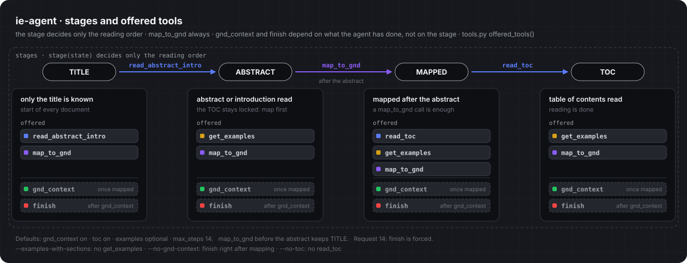

# ie-agent

Agentic subject indexing with GND subject headings. A language model assigns headings the way human indexers work
(from the interviews): title first, then abstract or introduction if needed, then map candidates onto the GND, then
the table of contents if still needed. Before finishing it checks its candidates in the GND graph (`gnd_context`).

## Quick start

**Needed beforehand** (all from the main project KI-FS Prompt, `paths.root` in `config.yaml`):

| what | why | where it is set |
|---|---|---|
| outputs of the KI-FS Prompt pipeline: `corpora/` (titles, `ground-truth.arrow`), `pipelines/preprocess/preprocessed/` (Sections, conditions), `pipelines/train/results/*_validate/retrieved_examples.csv`, `vocab/GND-Subjects-plus.ttl` | documents, gold, few-shot examples, GND vocabulary | `paths:` |
| Weaviate (port 8087) and Text Embeddings Inference (port 8090) running | `map_to_gnd` | `mapping:`; started with `docker-compose.yaml` of the main project |
| vLLM in the environment of the main project | starts the model | `server.vllm` |
| conda environment `r-eval` with casimir | `scores_at_100_R.yaml` after every run | `scoring.rscript` |
| a free GPU (A100 80 GB) | the model | `--gpu N` |

**Once, on a new machine or after cloning:**

```bash
cd ~/ki-fsprompt/ie_agnet
uv sync                                   # the environment of this project (tests, notebooks, uv run)
uv tool install --editable . --force      # the command ie-agent, usable from any folder
ie-agent build-gnd                        # downloads and builds the GND knowledge into gnd_graph/ (about 40 s)
```

`uv tool install` puts `ie-agent` into `~/.local/bin`, which is on the `PATH` (open a new terminal if the command
is not found yet). Because of `--editable`, changes to the code take effect at once. Only when the dependencies in
`pyproject.toml` change, repeat `uv tool install --editable . --force` once. `build-gnd` needs internet; skip it when
`gnd_graph/` already holds `graph.pkl` and `details.pkl`. The first start of a model downloads it from Hugging Face
(about 30 GB), so the first run waits longer before the server is ready.

**Every time:**

```bash
ie-agent --gpu 1 run             # one complete run on GPU 1
```

This starts the language model on GPU 1, waits until it is ready, annotates all documents, writes the results to
`ie_agnet/results/` and stops the model again. Run it inside `tmux`, then you can close the terminal (`Ctrl+b`, then
`d`) and come back later with `tmux attach`.

`ie-agent` works from any folder: results, GND data and `eval_ids.txt` are found relative to the `ie_agnet` folder.
Without the installation, use `uv run ie-agent …` inside the `ie_agnet` folder.

## What a run does by default

`ie-agent --gpu 1 run` without further options uses the values in `config.yaml`:

| setting | default | change with |
|---|---|---|
| model | Qwen3.8-27B-FP8 (`qwen` under `models:`) | `--model muse` |
| where the model runs | started on the GPU you name, port 9516 + N, stopped at the end | `--gpu N`, or `--port` for a running server |
| documents | all 827 documents of the validate split | `--ids eval_ids.txt` (100 fixed ones), `--n 50` (random sample) |
| reasoning | off | `--reasoning` |
| `gnd_context` (check in the GND graph) | on | `--no-gnd-context` |
| table of contents (`read_toc`) | available | `--no-toc`: title, then abstract or introduction |
| examples for abstract and table of contents | optional: the model asks for them with `get_examples` | `--examples-with-sections`: always delivered with each section |
| steps per document | at most 14, `finish` is forced in the last one | `--max-steps N` |
| output tokens per step | 2048 (8192 with reasoning) | `--max-tokens N` |
| documents in parallel | 8 | `--parallel N` |
| results | `results/Qwen3.8-27B-FP8/reasoning-off_gnd_context-on_toc-on_examples-optional/` | follows the conditions; `--name X` for an own folder name |


Options that change the run (`--model`, `--gpu`, `--reasoning`, …) go **before** the command, options of the
command (`--ids`, `--force`) **after** it:

```bash
ie-agent --gpu 1 --reasoning --no-gnd-context run --ids eval_ids.txt
#        └──── how the agent works ─────┘     └ which documents ┘
```

## Typical tasks

```bash
# a run with other conditions: it finds its own folder
ie-agent --gpu 1 --reasoning run
ie-agent --gpu 1 --examples-with-sections run --ids eval_ids.txt

# your own documents: --ids takes a file with one doc_id per line, not the ID itself (validate split only)
ie-agent --gpu 1 run --ids my_ids.txt --name my_test

# without the table of contents
ie-agent --gpu 1 --no-toc run

# another model (defined under models: in config.yaml)
ie-agent --gpu 1 --model muse run

# use a model server that is already running (no --gpu)
ie-agent --port 9516 run

# all 8 combinations of reasoning × gnd_context × examples: one run per combination on a running server,
# each [option] either given or left out (2 × 2 × 2 = 8 runs, each finds its own folder)
ie-agent --port 9517 [--reasoning] [--no-gnd-context] [--examples-with-sections] run

# look at one document: every step with the model's reasoning in results/<model>/traces/
ie-agent --gpu 1 --reasoning trace --doc-id 1007748524
```

A run that was interrupted (error, `Ctrl+C`, power cut) is continued by starting the same command again: finished
documents are kept, only the missing ones run.

## Watching a run and reading the results

```bash
wc -l ~/ki-fsprompt/ie_agnet/results/Qwen3.8-27B-FP8/*/log.jsonl # documents done so far, per run
tail -f ~/ki-fsprompt/ie_agnet/results/vllm_gpu1.log             # what the model server on GPU 1 is doing
ie-agent summary                        # table of all runs: P, R, F1, headings, steps, aborts, time, tokens
ie-agent summary --ids eval_ids.txt     # the same, all runs on the same 100 documents
```

`summary` scores against the title gold (set precision, recall and F1 per document, averaged); documents without a
result count as 0. Compare runs only on the same documents (`--ids`): two runs on different documents can differ by
several points by chance.

### Where results go

```
results/
  Qwen3.8-27B-FP8/
    reasoning-off_gnd_context-on_toc-on_examples-optional/    one folder per run, named after its conditions
    reasoning-off_gnd_context-on_toc-off_examples-optional/
    traces/                     reasoning traces (ie-agent trace)
  vllm_gpu<N>.log               output of the last model server on GPU N, overwritten at every start
```

| file | content |
|---|---|
| `log.jsonl` | one line per document: assigned GND IDs, suggestions with scores, every step, tokens, seconds, abort reason |
| `analysis.md`, `analysis.json` | written after every run: date (`created`), tool usage, F1 per decision branch, hits per tool, what `gnd_context` kept and dropped, where gold headings got lost (selection or recall error) and how many recall errors GND neighbours or joint assignment in training would have reached; repeat with `ie-agent analyze --name <folder>` |
| `settings.json` | model, conditions, full configuration, system prompt, prompt hash, git commit, start, every resume, end (`finished`) |
| `mapped_predictions.csv` | the pipeline format, readable by `compute_metrics.R` |
| `index.arrow` | the documents of the run, for the scoring in R (documents without a heading count as 0) |
| `scores_at_100_R.yaml` | written after every run: F1, precision, recall, R-precision and PR-AUC with casimir, in the format of `src/compute_metrics.R` of KI-FS Prompt (PR-AUC in the same file) (R environment `r-eval`); repeat with `ie-agent score --name <folder>` |
| `resource_stats.json`, `gpu_log.csv` | written after every run, as `src/completion.py` of KI-FS Prompt: time (all parts of a resumed run added up), tokens per document, and with `--gpu` energy (Wh), power, GPU utilization and memory from `nvidia-smi` once per second (whole GPU, also other processes on it). Without `--gpu` (a server already running) the energy fields stay empty |

A folder is never overwritten by accident:

| the folder already holds | what `run` does |
|---|---|
| nothing | starts a new run |
| a run with the same model, conditions and prompt | continues it |
| a run with other conditions or another prompt | stops with an error and changes nothing |
| anything, and `--force` is given | deletes `log.jsonl`, `settings.json`, `mapped_predictions.csv`, `index.arrow`, `scores_at_100_R.yaml`, `resource_stats.json`, `gpu_log.csv` and the analysis of that folder and starts anew |

Every run gets its folder from its conditions, so runs with other conditions never collide. `--name X` gives a run
an own folder name instead:

| part of the name | condition | option |
|---|---|---|
| `reasoning-on/off` | reasoning of the model | `--reasoning` |
| `gnd_context-on/off` | `gnd_context` (check in the GND graph) | `--no-gnd-context` |
| `examples-optional/forced` | examples only on request, or always with each section | `--examples-with-sections` |
| `toc-on/off` | table of contents available | `--no-toc` |
| `_examples-gnd`, `_steps-N` | only added when not default | `--examples-gnd`, `--max-steps` |

## When something goes wrong

| message or symptom | cause and fix |
|---|---|
| `A server already answers on port …` | a model server is still running. Stop it, or use it: leave out `--gpu` and give its port, e.g. `--port 9517` (9516 + GPU). |
| `The server stopped while starting, see results/vllm_gpu<N>.log` | the model could not start; the end of `results/vllm_gpu<N>.log` says why. Often the GPU is busy (`nvidia-smi`). |
| `… already holds another run` | the folder holds a run with other conditions or another prompt. Use `--name` for another folder, or `--force` to delete the old results. |
| `No GND data in …` | run `ie-agent build-gnd` once. |
| `ie-agent: command not found` | not installed yet, or the terminal is older than the installation: run `uv tool install --editable . --force` in the `ie_agnet` folder and open a new terminal. |
| `bad interpreter: …/.venv/bin/python` or `No module named 'ie_agent'` after moving or renaming the folder | `.venv` and the installed command still point to the old folder. In the `ie_agnet` folder: `rm -rf .venv && uv sync && uv tool install --editable . --force`. |
| `Model '…' is not under models:` | the model is unknown in `config.yaml`: add it under `models:`, or give its running server with `--port`. |
| `.venv/bin/vllm: No such file or directory` when starting vLLM by hand | vLLM lives in the environment of the main project: `~/ki-fsprompt/.venv/bin/vllm`. With `--gpu` you do not need to start it yourself. |
| many `max_steps` aborts | the model ignores the forced `finish` (seen with Muse); its documents then get all mapped candidates. |

## How it works

### Layout

```
config.yaml        all settings: models, paths, limits, defaults
prompts/           what the model reads (German, like the documents; tool names English)
src/ie_agent/
  config.py        config.yaml plus the command line options
  data.py          documents, gold, few-shot examples, mapping (Weaviate + TEI)
  gnd/             the GND knowledge graph
    build.py       ie-agent build-gnd: DNB downloads, Turtle parser, gnd_graph/*.pkl and manifest
    graph.py       Gnd at run time: broader, narrower, related terms, frequency and co-assignment in training
    context.py     what gnd_context shows the model about a candidate
  tools.py         TOOLS and GND_CONTEXT_TOOL as the model sees them, IE policy, tool implementations
  agent.py         the loop for one document
  runs.py          one batch run and its result folder (log, settings, predictions, scores, traces)
  resources.py     resource_stats.json: time, tokens, GPU energy (nvidia-smi into gpu_log.csv)
  server.py        starting and stopping the model server
  cli.py           the commands
  evaluation/      compute_scores.R (scores_at_100_R.yaml, casimir) and analysis.py (P/R/F1, analysis.md, analysis.json)
tests/             fake model and fake data, no GPU (uv run pytest)
eval_ids.txt       fixed evaluation set: 100 of the 827 validate documents
walkthrough.ipynb  one document step by step: data, policy, every tool call, optionally the live model
walkthrough_examples_with_sections.ipynb   the same for the variant examples_with_sections
walkthrough_wissensgraph.ipynb   how the GND knowledge graph is built, what it looks like, how complete it is
gnd_graph/         GND knowledge for gnd_context, built with `ie-agent build-gnd` (only manifest.json is in git)
```

### IE policy (`tools.py`)

The agent reads a document the way human indexers do (from the interviews): title first, then the abstract or
introduction if needed, then it maps its candidates onto the GND, and only then, if something is still missing, the
table of contents. In every request the model only sees the tools it may use now.



**Stages.** The stage is not stored but derived from the state of the document (`stage()`), and it only decides the
reading order (`next_section()`):

| stage | reached by | the model may read |
|---|---|---|
| TITLE | start of every document | the abstract or introduction (`read_abstract_intro`) |
| ABSTRACT | `read_abstract_intro` | nothing: map first |
| MAPPED | `map_to_gnd` after the abstract (the call is enough, even without a hit) | the table of contents (`read_toc`) |
| TOC | `read_toc` | nothing, reading is done |

Mapping before the abstract keeps the stage TITLE. Every section is read at most once.

**Tools.** `offered_tools()` decides which tool schemas the model gets in a request:

| tool | offered when |
|---|---|
| `map_to_gnd` | always |
| `read_abstract_intro` | stage TITLE |
| `read_toc` | stage MAPPED (not with `--no-toc`) |
| `get_examples` | for sections already read; the title examples are in the first message (not with `--examples-with-sections`) |
| `gnd_context` | as soon as at least one candidate was mapped (not with `--no-gnd-context`) |
| `finish` | after a `gnd_context` call (with `--no-gnd-context`: after the first mapping), or forced in the last step |

`gnd_context` and `finish` do not depend on the stage, only on what the agent has done: the model may also map,
check and finish from the title alone. If the model calls a tool it was not offered, `check_call()` refuses it and
explains the order instead.

**Guards in the loop (`agent.py`).** Only GND IDs seen through a tool (`map_to_gnd` or `gnd_context`) may be assigned;
unknown IDs in `finish()` are sent back up to twice. An answer without a tool call is asked again, then `finish()` is
forced. In the last step (14) `finish()` is forced via `tool_choice`. A full context window ends the document with
every mapped candidate.

**Conditions.** With `--examples-with-sections`, `read_abstract_intro` and `read_toc` always return the 5 examples of
their section, as in the pipeline conditions. With `--no-gnd-context` the tool is not offered, its part of the prompt is
left out and `finish` is offered as soon as something was mapped; everything else stays the same (also the 14 steps),
so the comparison isolates `gnd_context`. The parts of the system prompt that depend on the conditions are in
`prompts/system_parts.yaml`.

**Changing a tool.** `TOOLS` / `GND_CONTEXT_TOOL` define what the model sees, `ToolRunner.run` what happens, and
`offered_tools` / `check_call` when it is allowed. Changing what the model sees changes the prompt hash, so runs
started before can no longer be resumed. To add a model, add it under `models:` in `config.yaml` (its Hugging Face
name, a free port and the vLLM arguments, especially the tool call parser).

### GND knowledge (`gnd_graph/`)

The GND subject headings of KI-FS Prompt (`vocab/GND-Subjects-plus.ttl`, the vocabulary of the pipeline that is also
in Weaviate) provide the terms and their broader, narrower and related terms. We enriched them with official files
of the Deutsche Nationalbibliothek:

| file | source | adds |
|---|---|---|
| `authorities-gnd-sachbegriff_lds.ttl.gz` | DNB open data, https://data.dnb.de/opendata/ (CC0) | definitions, using instructions, subject category codes of subject headings |
| `authorities-gnd-geografikum_lds.ttl.gz` | DNB open data, https://data.dnb.de/opendata/ (CC0) | descriptions and subject category codes of places |
| `gnd-sc.ttl` | GND subject categories, https://d-nb.info/standards/vocab/gnd/gnd-sc.html | names of the subject categories |

The DNB dumps identify terms by GND number (e.g. `4329222-7`), KI-FS Prompt by IDN (e.g. `940053241`). They are
matched by the preferred name in Unicode NFC (the dumps store many names decomposed, e.g. "a" + combining
diaeresis), only where the name occurs once in the vocabulary and once in the dumps.

| of 309,417 terms | count |
|---|---|
| with details (subject category etc.) | 197,252 |
| with a definition | 47,127 |
| with a description (mostly places) | 14,449 |
| with using instructions | 10,951 |

Broader and narrower terms come from the vocabulary; the DNB dumps add only the kind of the relation (kind of, part
of, instance of), which `gnd_context` shows where the GND records it. If a term has more narrower terms than fit
(`max_narrower`), those named in the text come first, then those closest in meaning to the document (vectors in
Weaviate).

`gnd_context` shows definition, description and using instructions where they exist. `build-gnd` writes
`manifest.json` with URL, download date, `Last-Modified` and SHA-256 of every source, so each run can be traced back
to the exact GND version. Rebuild when the DNB publishes a new dump; results are then no longer directly comparable
with older runs.